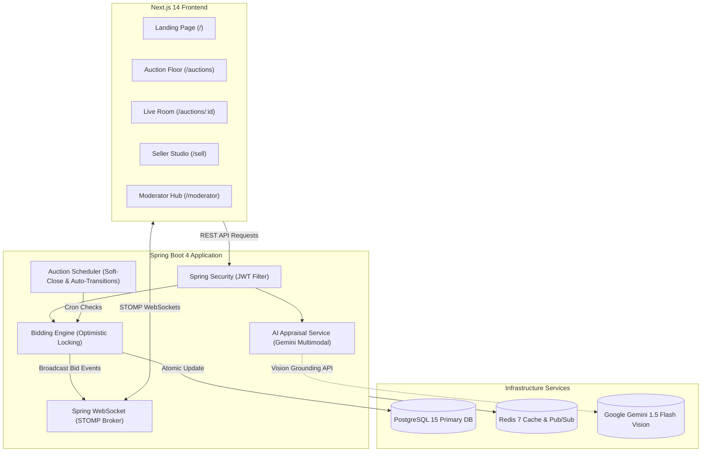

# VeryBid 🚀
> **AI-Powered Verified Online Auction Platform for Rare Collectibles**

[](https://spring.io/projects/spring-boot)
[](https://nextjs.org/)
[](https://www.postgresql.org/)
[](https://redis.io/)
[](https://www.docker.com/)

---

## 📖 Tổng quan dự án

**VeryBid** là sàn đấu giá trực tuyến chuyên biệt cho phân khúc **Đồ sưu tầm & Hàng hiếm** (Diecast models, thiết bị retro vintage tech, sneaker giới hạn, đồng hồ luxury, thẻ bài quý hiếm). 

Nền tảng giải quyết bài toán lớn nhất của thị trường thứ cấp: **Niềm tin và tính xác thực (Trust & Authenticity)**. Nhờ tích hợp trí tuệ nhân tạo **Multimodal AI (Gemini Vision)** để thẩm định ảnh đa góc, chấm điểm **Trust Score**, cùng công cụ đấu giá thời gian thực hỗ trợ **Anti-Sniping (Soft Close)** và **Optimistic Locking**, VeryBid mang đến trải nghiệm đấu giá minh bạch, sòng phẳng và kịch tính.

---

## ⚡ Khởi động 1-Click với Docker (Quick Start)

Dự án đã được đóng gói tự động hóa 100%. Bạn **không cần cài đặt PostgreSQL hay Redis thủ công**, và **không cần chạy bất kỳ file SQL nào**. Hibernate và Seeder sẽ tự động tạo bảng và nạp sẵn dữ liệu mẫu.

### 1. Yêu cầu hệ thống
- Đã cài đặt [Docker](https://docs.docker.com/get-docker/) & [Docker Compose](https://docs.docker.com/compose/install/).

### 2. Khởi chạy toàn bộ hệ thống
Mở terminal tại thư mục gốc của dự án và gõ đúng **1 lệnh duy nhất**:

```bash
docker compose up -d --build
```

### 3. Truy cập ứng dụng
Sau khi các container khởi động hoàn tất (khoảng 30-45 giây):

| Dịch vụ | URL Truy Cập | Chức năng |
| :--- | :--- | :--- |
| **Frontend Web** | [http://localhost:3000](http://localhost:3000) | Giao diện sàn đấu giá, phòng live, đăng bán & kiểm duyệt |
| **Backend REST API** | [http://localhost:8080/api/v1](http://localhost:8080/api/v1) | Toàn bộ RESTful endpoints và tài nguyên |
| **WebSocket STOMP** | `ws://localhost:8080/ws` | Kênh truyền phát giá thầu thời gian thực |
| **PostgreSQL Database** | `localhost:5432` (db: `verybid_db`) | Cơ sở dữ liệu chính |
| **Redis Cache** | `localhost:6379` | Bộ nhớ tạm & Distributed Locks |

---

## 🔑 Tài khoản mẫu có sẵn (Pre-seeded Accounts)

Hệ thống đã tự động kích hoạt 3 tài khoản thử nghiệm với mật khẩu chung: `password123`:

| Tài khoản | Email | Mật khẩu | Quyền hạn |
| :--- | :--- | :--- | :--- |
| **Ban Kiểm Duyệt** | `admin@verybid.com` | `password123` | Toàn quyền duyệt sản phẩm tại `/moderator` |
| **Người Bán Xác Thực** | `seller@verybid.com` | `password123` | Nộp sản phẩm thẩm định tại `/sell` |
| **Nhà Sưu Tầm** | `bidder@verybid.com` | `password123` | Tham gia đấu giá tại `/auctions/[id]` |

---

## 📐 Kiến trúc hệ thống (System Architecture)



---

## ✨ Các tính năng cốt lõi (Core Features)

### 1. 🤖 AI Multimodal Appraisal (Thẩm định AI Đa Góc)
- Người bán gửi **5 góc chụp tiêu chuẩn**: Mặt trước (`FRONT`), Mặt sau (`BACK`), Tem kiểm định/Mã Serial (`SERIAL_NUMBER`), Hộp & Bao bì (`PACKAGING`), Chi tiết vết trầy (`SCRATCH_DETAIL`).
- AI Gemini Vision phân tích tự động:
  - Nhận diện chính xác Model sản phẩm và năm sản xuất.
  - Đối chiếu mã tem serial và phát hiện lỗi trầy xước.
  - Tính toán khoảng giá thị trường (`marketPriceMin` - `marketPriceMax`).
  - Gắn nhãn xác thực (`riskFlags`) và cấp điểm **Trust Score (0–100)**.

### 2. 🛡️ Moderator Review & Auto-Launch (`/moderator`)
- Giao diện đối soát chuyên nghiệp dành cho Ban Kiểm Duyệt: So sánh giữa *Khai báo người bán* vs *Kết luận của AI*.
- Phê duyệt 1 chạm kèm tùy chọn **tự động lập phiên đấu giá lên sàn ngay lập tức**.

### 3. ⚡ Phòng đấu giá thời gian thực (`/auctions/[id]`)
- Đồng bộ bước giá và lượt đấu thầu thời gian thực qua kênh WebSocket STOMP sub-second.
- **Quy tắc Chống Giật Giây Chót (Soft-Close / Anti-Sniping):** Mọi lượt bid trong 2 phút cuối sẽ tự động gia hạn thêm 2 phút để bảo đảm công bằng.
- **Tùy chọn Mua Ngay (Instant Buy-Now):** Cho phép người mua chốt món đồ ngay lập tức theo giá niêm yết mà không cần chờ hết giờ.
- **Chống tranh chấp (Concurrency Control):** Cơ chế **Optimistic Locking** (`@Version`) ngăn chặn xung đột khi hàng trăm người bấm bid cùng một mili-giây.

---

## 📋 Yêu cầu chức năng

### 1. Tài khoản Quản trị viên (Admin)
- Quản lý dữ liệu hệ thống theo CRUD: tài khoản người dùng, danh mục, sản phẩm, phiên đấu giá và các báo cáo AI.
- Thiết lập trạng thái phiên đấu giá, theo dõi lịch sử thao tác và xử lý các trường hợp vi phạm quy định sàn.

### 2. Tài khoản Kiểm duyệt viên (Moderator)
- Kiểm duyệt sản phẩm **sau khi** hệ thống AI hoàn tất kiểm tra.
- Đối chiếu thông tin người bán khai báo với báo cáo AI: loại hàng, nhận dạng sản phẩm, tình trạng, cờ rủi ro và giá trị ước tính.
- Chỉ cho phép sản phẩm có xác nhận kiểm duyệt được tạo hoặc công khai trong phiên đấu giá; có thể yêu cầu bổ sung thông tin hoặc từ chối hồ sơ kèm lý do.

### 3. Kiểm tra bằng AI
- Chỉ khởi tạo thẩm định khi người dùng tải đủ số ảnh tối thiểu và đầy đủ các góc ảnh bắt buộc của sản phẩm.
- AI nhận dạng sản phẩm, kiểm tra tính nhất quán giữa ảnh và thông tin khai báo, đồng thời phát hiện các dấu hiệu rủi ro như thiếu tem/mã serial hoặc ảnh không phù hợp.
- Kết quả AI phải bao gồm: loại hàng đề xuất, thông tin nhận dạng, mô tả/tình trạng, giá trị ước tính và điểm tin cậy để kiểm duyệt viên ra quyết định.

### 4. Tài khoản khách hàng (Người mua / Người đăng đấu giá)
- Xem danh sách và lịch các phiên đấu giá sắp diễn ra; xem chi tiết sản phẩm và thông tin xác thực trước khi tham gia.
- Người bán có thể tạo hồ sơ đăng sản phẩm lên sàn, nhưng phải cung cấp tối thiểu số ảnh theo quy định và đủ các góc chụp bắt buộc.
- Hồ sơ đăng tải bắt buộc có: **loại hàng, giá trị ước tính, mô tả và bộ ảnh xác thực**. Sản phẩm chỉ được đăng bán sau khi nhận xác nhận kiểm duyệt.

### 5. Quy tắc xác nhận sản phẩm
- Mỗi sản phẩm phải lưu vết kết quả AI và quyết định kiểm duyệt (người duyệt, thời điểm, trạng thái và lý do nếu từ chối/yêu cầu bổ sung).
- Trạng thái tối thiểu: `DRAFT` → `PENDING_AI_CHECK` → `PENDING_MODERATION` → `APPROVED` hoặc `REJECTED` / `NEEDS_MORE_INFO`.
- Sản phẩm chưa ở trạng thái `APPROVED` không được phép xuất hiện trong lịch hoặc phòng đấu giá công khai.

---

## 💻 Hướng dẫn chạy Development (Local Hot-Reload)

Nếu bạn muốn chỉnh sửa code và tận dụng tính năng hot-reload:

### Bước 1: Khởi động cơ sở dữ liệu nền bằng Docker
```bash
docker compose up -d postgres redis
```

### Bước 2: Chạy Backend Spring Boot
```bash
cd backend
./mvnw spring-boot:run
```
*(Hoặc mở thư mục `backend` bằng IntelliJ IDEA và bấm Run `BackendApplication`)*

### Bước 3: Chạy Frontend Next.js
```bash
cd frontend
npm install
npm run dev
```
Truy cập `http://localhost:3000` để bắt đầu lập trình.

### Bước 4: Chạy bộ kiểm thử (Test Suite)
```bash
cd backend
./mvnw test
```
Toàn bộ 27/27 bài kiểm thử tích hợp (Unit & Integration Tests) sẽ được thực thi trên môi trường in-memory database độc lập.

---

## 📂 Cấu trúc thư mục (Project Directory)

```text
VeryBid/
├── backend/                  # Mã nguồn Spring Boot 4
│   ├── src/main/java/com/verybid/backend/
│   │   ├── config/           # DatabaseSeeder, SecurityConfig, WebSocketConfig
│   │   ├── controller/       # Auction, Auth, Category, Item controllers
│   │   ├── dto/              # Requests, Responses, WebSocket Event payloads
│   │   ├── model/entity/     # User, Item, Auction, Bid, ItemAIReport, Transaction
│   │   ├── repository/       # Spring Data JPA interfaces
│   │   ├── service/          # AiAppraisalService, BidService, AuctionService, etc.
│   │   └── websocket/        # Real-time STOMP event publisher
│   └── Dockerfile            # Multi-stage container build cho Backend
├── frontend/                 # Mã nguồn Next.js 14 (App Router)
│   ├── src/
│   │   ├── app/              # Trang chủ, /auctions, /sell, /moderator, /auth
│   │   ├── components/       # CountdownTimer, Navbar, UI elements
│   │   ├── context/          # AuthContext (quản lý phiên đăng nhập)
│   │   ├── hooks/            # useAuctionWebSocket (kết nối STOMP real-time)
│   │   └── services/         # Axios API clients
│   ├── public/               # Static assets & icons
│   └── Dockerfile            # Standalone Next.js production container
├── docs/                     # Tài liệu thiết kế CSDL (DATABASE_DESIGN.md)
├── docker-compose.yml        # Orchestration 4 microservices (DB, Cache, API, Web)
├── .env.example              # Mẫu biến môi trường
└── README.md                 # Tài liệu hướng dẫn chính
```

---

## 📜 Bản quyền & Giấy phép
Dự án được xây dựng và duy trì bởi nhóm phát triển **VeryBid** © 2026. Phục vụ mục đích học tập, nghiên cứu và triển khai hệ thống đấu giá trực tuyến thế hệ mới.
