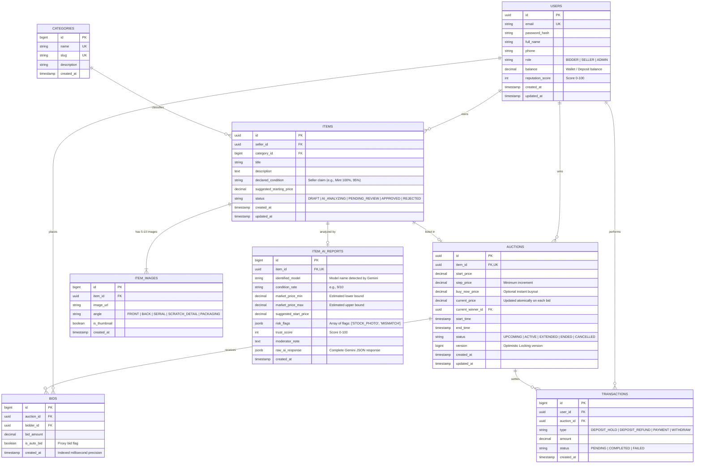

# VeryBid - Database Architecture & Design 🗄️

Tài liệu thiết kế cơ sở dữ liệu chi tiết cho hệ thống đấu giá trực tuyến **VeryBid**, tích hợp kiểm duyệt đa phương tiện bằng AI và cơ chế chống tranh chấp giao dịch giây chót (Concurrency Control).

---

## 1. Sơ đồ thực thể quan hệ (ERD - Entity Relationship Diagram)

---

## 2. Chi tiết cấu trúc các bảng

### 2.1. Bảng `users`
- **Mục đích:** Quản lý danh tính, phân quyền và số dư ví cọc của người tham gia.
- **Ràng buộc:**
  - `email`: UNIQUE, NOT NULL.
  - `role`: Enum (`BIDDER`, `SELLER`, `ADMIN`).
  - `balance`: Mặc định `0.00`, không được âm (`CHECK (balance >= 0)`).

### 2.2. Bảng `categories`
- **Mục đích:** Phân loại sản phẩm sưu tầm (Diecast Model, Vintage Tech, Sneaker...).
- **Ràng buộc:**
  - `slug`: UNIQUE (hỗ trợ SEO cho Next.js).

### 2.3. Bảng `items`
- **Mục đích:** Lưu thông tin món hàng ở giai đoạn nộp hồ sơ chờ duyệt.
- **Quan hệ:** N-1 với `users` (seller_id) và N-1 với `categories`.
- **Trạng thái (`status`):**
  - `DRAFT`: Người bán đang tạo, chưa nộp đủ ảnh.
  - `AI_ANALYZING`: Đã nộp 5-10 ảnh, đang chờ RabbitMQ worker gọi Gemini API.
  - `PENDING_REVIEW`: AI đã xuất report, chờ Moderator/Admin duyệt.
  - `APPROVED`: Được duyệt, sẵn sàng lên sàn đấu giá.
  - `REJECTED`: Bị từ chối (ảnh mờ, nghi hàng fake, mô tả sai sự thật).

### 2.4. Bảng `item_images`
- **Mục đích:** Lưu trữ tối thiểu 5–10 góc chụp chi tiết của sản phẩm.
- **Quan hệ:** N-1 với `items` (`ON DELETE CASCADE`).
- **Góc chụp (`angle`):** Bắt buộc người bán khai rõ góc để AI dễ bóc tách lỗi và số serial.

### 2.5. Bảng `item_ai_reports`
- **Mục đích:** Lưu kết quả phân tích đa phương thức (Multimodal Vision) và định giá từ Google Gemini.
- **Quan hệ:** 1-1 với `items`.
- **Cột đặc biệt:**
  - `raw_ai_response`: Kiểu dữ liệu `JSONB` lưu toàn bộ payload JSON trả về từ LLM để truy vết sau này.
  - `trust_score`: Thang điểm 0–100 giúp Moderator duyệt nhanh trong 5 giây.

### 2.6. Bảng `auctions` (Trọng tâm hệ thống)
- **Mục đích:** Quản lý vòng đời và trạng thái trực tiếp của phòng đấu giá.
- **Quan hệ:** 1-1 với `items`.
- **Cơ chế kỹ thuật cốt lõi:**
  - **`version` (Optimistic Locking):** Trường số nguyên tăng dần mỗi khi có lượt bid thành công. Dùng để chặn race condition khi 100 người cùng bấm bid ở giây thứ 59.
  - **`buy_now_price`:** Nếu người mua trả mức giá này, phiên chốt ngay lập tức.
  - **`status`:** Trạng thái `EXTENDED` biểu thị phiên vừa được tự động cộng thêm 2 phút nhờ cơ chế Anti-sniping.

### 2.7. Bảng `bids` (Write-Heavy)
- **Mục đích:** Lưu lịch sử toàn bộ các lượt trả giá.
- **Index quan trọng:**
  - Composite Index: `(auction_id, created_at DESC)` để lấy nhanh top giá mới nhất cho WebSocket STOMP.

### 2.8. Bảng `transactions`
- **Mục đích:** Lưu vết dòng tiền (Giữ cọc trước khi vào phòng đấu giá, hoàn cọc cho người thua, trừ tiền người thắng).

---

## 3. Chiến lược Index & Tối ưu hiệu năng (Performance Strategy)

| Tên bảng | Index | Mục đích tối ưu |
| :--- | :--- | :--- |
| `auctions` | `(status, end_time)` | Background Scheduler truy vấn siêu tốc các phiên sắp hết hạn để chốt phiên hoặc kích hoạt Anti-sniping |
| `bids` | `(auction_id, bid_amount DESC)` | Tìm nhanh giá cao nhất hiện tại của phiên |
| `bids` | `(auction_id, created_at DESC)` | WebSocket phát sóng lịch sử đặt giá gần nhất |
| `items` | `(seller_id, status)` | Lọc danh sách đồ của người bán trong Dashboard |
